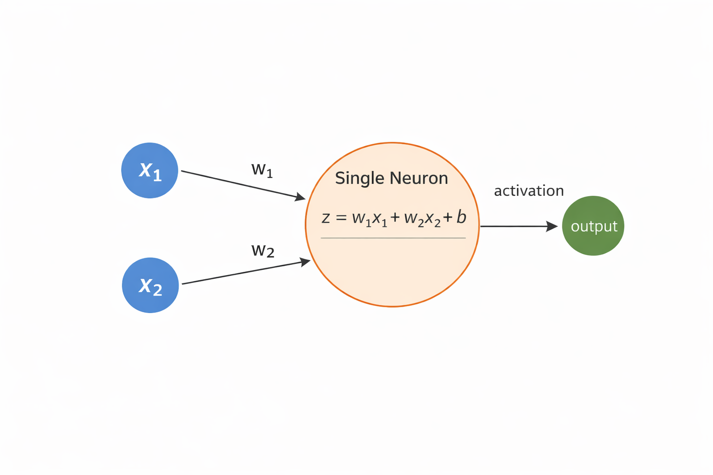

# Neural Networks from Scratch to PyTorch


Learn how neural networks really work, from a single neuron built with NumPy to a small
attention-based text classifier in PyTorch.

The first notebooks build a perceptron **from scratch**, with no high-level ML libraries.
They show every computation: forward propagation, the cost function, derivatives from the
chain rule, and gradient descent. The later notebooks use **PyTorch** to train a network
for images (MNIST) and a network for text with embeddings and self-attention.



## Learning path

| # | Notebook | What you build | Key concepts | Open |
|---|----------|----------------|--------------|------|
| 1 | [Perceptron for regression](perceptron_for_regression.ipynb) | A single neuron that predicts house prices from `houses.csv` | Linear model, sum-of-squares cost, gradient descent | [](https://colab.research.google.com/github/mzarnecki/neural-network-perceptron-in-python/blob/main/perceptron_for_regression.ipynb) |
| 2 | [Perceptron for classification](perceptron_for_classification.ipynb) | A binary classifier for linearly separable points | Sigmoid, log loss, chain-rule derivatives, decision boundary | [](https://colab.research.google.com/github/mzarnecki/neural-network-perceptron-in-python/blob/main/perceptron_for_classification.ipynb) |
| 3 | [Image classification with PyTorch](train_image_neural_network_with_pytorch.ipynb) | A multilayer network that recognises MNIST digits | `nn.Sequential`, `DataLoader`, `CrossEntropyLoss`, Adam, GPU training | [](https://colab.research.google.com/github/mzarnecki/neural-network-perceptron-in-python/blob/main/train_image_neural_network_with_pytorch.ipynb) |
| 4 | [Text classification with PyTorch](train_text_neural_network_with_pytorch.ipynb) | A small attention model that answers questions about word order | Tokenization, token and position embeddings, multi-head self-attention | [](https://colab.research.google.com/github/mzarnecki/neural-network-perceptron-in-python/blob/main/train_text_neural_network_with_pytorch.ipynb) |

Extra reading: [Intuitive explanation of the single-neuron classifier](perceptron_binary_classifier_explanation.md)
explains notebook 2 step by step, from the geometry of a separating line to the final predictions.

## Notebook highlights

### 1–2. Perceptron from scratch
- Every step is written in NumPy: parameter initialisation, forward propagation, cost, backpropagation and parameter updates.
- The derivatives of log loss are worked out by hand with the chain rule, so you can see where each gradient comes from.
- Plots show how the model fits the data during training.

### 3. Image classification (MNIST)
- A fully connected network (784 → 512 → 512 → 256 → 10) trained on handwritten digits.
- Uses the GPU automatically when one is available.
- Shows the standard PyTorch training loop: forward pass, loss, `zero_grad()`, `backward()`, `step()`.

### 4. Text classification with self-attention
The model reads a short sentence such as
*"At the finish: Gniewomir, Onufry. Who was first? Onufry or Gniewomir?"*
and picks the correct answer. If the finishing order is swapped, the answer changes, even though
the sentence contains the same tokens. So the model must learn **word order**, not just which words appear.

- Builds a vocabulary and turns text into tensors of token IDs.
- Learned **token embeddings** and **position embeddings**, followed by **multi-head self-attention** (`nn.MultiheadAttention`) with a residual connection and `LayerNorm`.
- Tests on name pairs never seen during training.
- **Live demo:** zero out the position embeddings and watch accuracy fall, which shows why transformers need positional information.
- Uses the same training loop as the MNIST notebook, so you can compare image and text pipelines side by side.
- Connects to chapters 2–3 of Sebastian Raschka's [*Build a Large Language Model (From Scratch)*](https://sebastianraschka.com/llms-from-scratch/).

## Getting started

Run any notebook in Google Colab with the badges above, or locally:

```bash
git clone https://github.com/mzarnecki/neural-network-perceptron-in-python.git
cd neural-network-perceptron-in-python
pip install numpy pandas matplotlib torch torchvision tqdm jupyter
jupyter notebook
```

The PyTorch notebooks install their missing dependencies in their first cell. The MNIST dataset
downloads automatically on first run.

## Who is this for?

- Students who want to understand the maths behind neural networks, not just call `model.fit()`.
- Developers moving from "how a neuron works" to real PyTorch code.
- Anyone curious how embeddings and attention, the building blocks of LLMs, work on a tiny example.

## License

[MIT](LICENSE)
